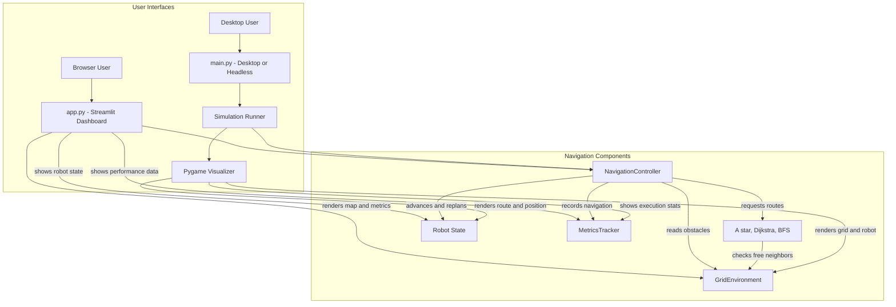
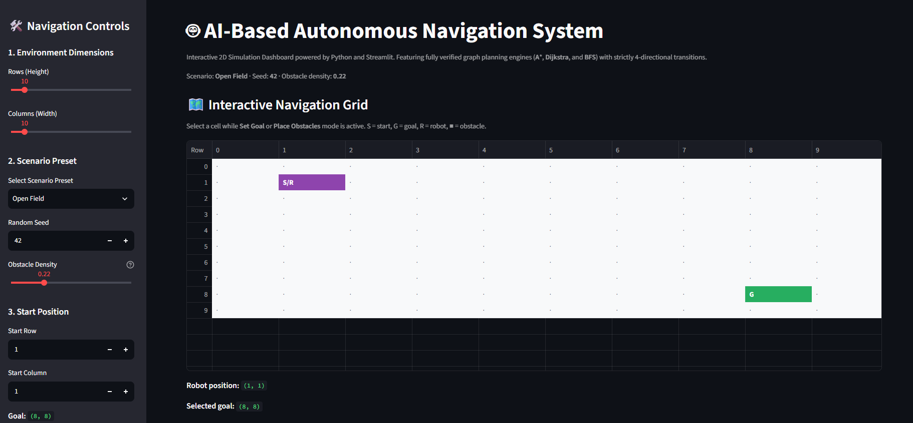
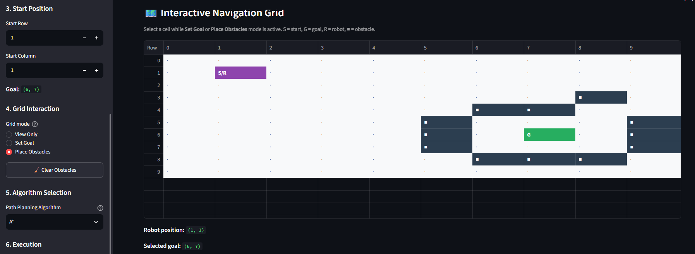
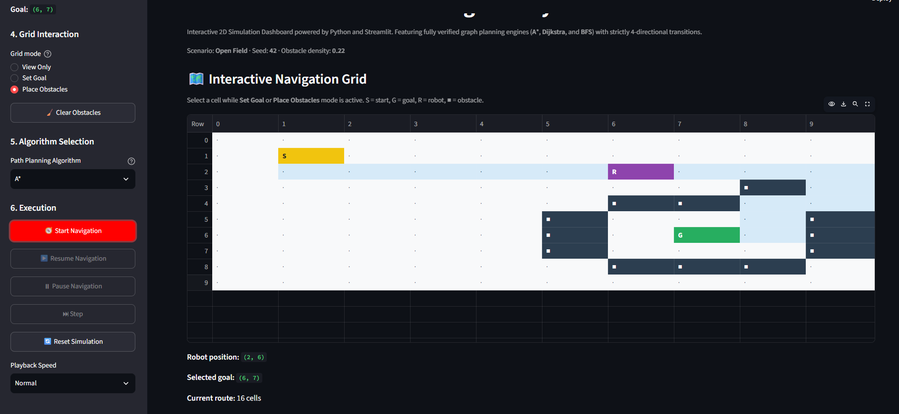
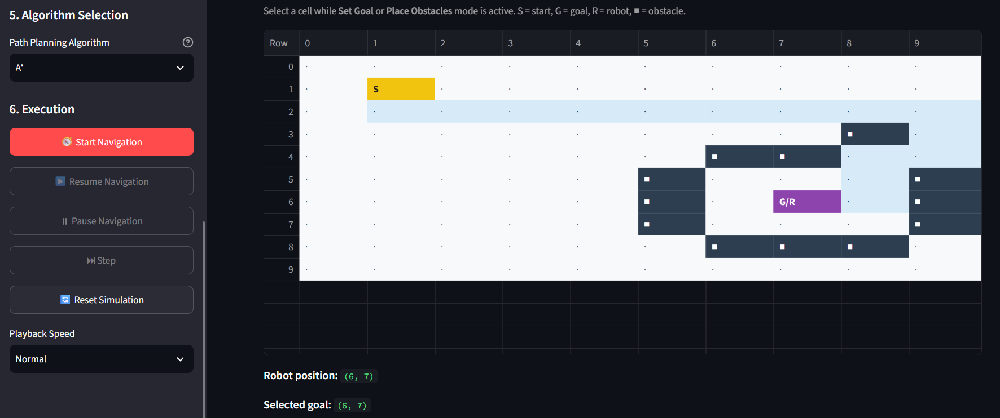
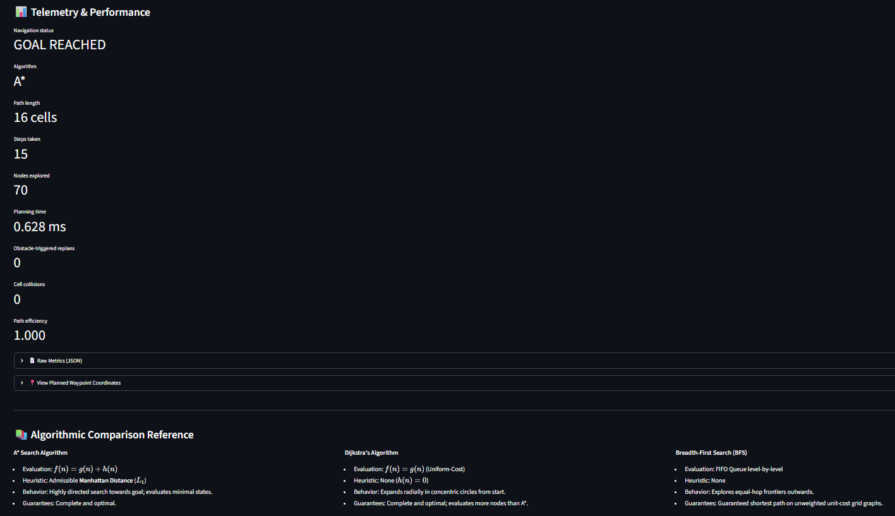

# AI-Based Autonomous Navigation System (2D Simulation)

An educational, modular Python project simulating an autonomous robot navigating a 2D occupancy grid, computing optimal collision-free paths using graph search algorithms (**A***, **Dijkstra**, and **BFS**), dynamically replanning around unexpected obstacles, and reporting execution metrics.

Supports two simulation interfaces:
1. **Interactive Streamlit Web Dashboard** (`app.py`): Browser-based visualization, reproducible scenario generation, and controller-driven live navigation.
2. **Pygame Desktop Simulation & Headless CLI** (`main.py`): Real-time interactive desktop window with mouse obstacle-toggling, and headless mode for automated testing.

---

## 1. Project Structure

The diagram highlights the main application files and the modules grouped under each project folder.

```mermaid
flowchart TD
    tRoot["AI-Based Autonomous Navigation System"]
    tReadme["README.md"]
    tRequirements["requirements.txt"]
    tIgnore[".gitignore"]
    tApp["app.py"]
    tMain["main.py"]
    tSrc["src/"]
    tTests["tests/"]
    tDocs["docs/"]
    tScreens["Screenshots/"]
    tAssets["assets/"]
    tResults["results/"]
    tInit["src/__init__.py"]
    tConfig["src/config.py"]
    tEnvironment["src/environment.py"]
    tPlanning["src/path_planning.py"]
    tRobot["src/robot.py"]
    tNavigation["src/navigation.py"]
    tMetrics["src/metrics.py"]
    tSimulation["src/simulation.py"]
    tTestInit["tests/__init__.py"]
    tEnvTests["tests/test_environment.py"]
    tPlanTests["tests/test_path_planning.py"]
    tAppTests["tests/test_streamlit_integration.py"]
    tArchDoc["docs/architecture.md"]
    tGuideDoc["docs/learning_guide_and_interview_qa.md"]
    tScreen1["Screenshots/01_AI_Nav_Grid.png"]
    tScreen2["Screenshots/02_Obstacle_Placed.png"]
    tScreen3["Screenshots/03_Live_Navigation.png"]
    tScreen4["Screenshots/04_Goal_Reached.png"]
    tScreen5["Screenshots/05_Simulation_Result.png"]
    tAssetsKeep["assets/.gitkeep"]
    tResultsKeep["results/.gitkeep"]

    tRoot --> tReadme
    tRoot --> tRequirements
    tRoot --> tIgnore
    tRoot --> tApp
    tRoot --> tMain
    tRoot --> tSrc
    tRoot --> tTests
    tRoot --> tDocs
    tRoot --> tScreens
    tRoot --> tAssets
    tRoot --> tResults
    tSrc --> tInit
    tSrc --> tConfig
    tSrc --> tEnvironment
    tSrc --> tPlanning
    tSrc --> tRobot
    tSrc --> tNavigation
    tSrc --> tMetrics
    tSrc --> tSimulation
    tTests --> tTestInit
    tTests --> tEnvTests
    tTests --> tPlanTests
    tTests --> tAppTests
    tDocs --> tArchDoc
    tDocs --> tGuideDoc
    tScreens --> tScreen1
    tScreens --> tScreen2
    tScreens --> tScreen3
    tScreens --> tScreen4
    tScreens --> tScreen5
    tAssets --> tAssetsKeep
    tResults --> tResultsKeep
```

<!-- mermaid-checked: no \n, no em-dash/en-dash, no {} in labels, subgraphs are id["label"], arrows are -->|"label"|, all subgraphs closed by end, ids unique -->


---

## 2. Key Architecture & Features

- **Strict Separation of Concerns**: Path planning operates purely on mathematical graph data structures. The planners do not import Pygame or Streamlit. The renderers never make planning decisions.
- **2D Occupancy Grid**:
  - `0 = Free Cell`
  - `1 = Occupied Obstacle Cell`
  - Logical coordinates are consistently represented as `(row, column)`.
- **Strictly 4-Directional Movement**: Moves are constrained to North, South, West, and East. Diagonal transitions are explicitly prohibited to prevent corner-cutting collisions.
- **Three Supported Planning Algorithms**:
  1. **A\* Search**: Uses the admissible Manhattan distance heuristic ($h(n) = |r_n - r_g| + |c_n - c_g|$) to guide search while finding an optimal route on this unit-cost grid.
  2. **Dijkstra's Algorithm**: Uniform-cost search ($h(n) = 0$), expanding the lowest-cost frontier first.
  3. **Breadth-First Search (BFS)**: FIFO queue search exploring level-by-level. Optimal step count for unit-cost grid graphs.
- **Dynamic Replanning**: The controller checks the next waypoint before moving and recalculates a route if that cell is blocked. The dashboard also replans after obstacle-map edits. If no alternative path exists, the robot transitions to `BLOCKED`.
- **Streamlit Live Playback**: The dashboard persists the controller and robot in session state, displays a selectable pandas-backed grid, supports manual single-step and timed playback, and lets users pause, resume, reset, and add/remove obstacles.
- **Seeded Scenario Generation**: Open, random, maze-like, corridor, U-trap, and unreachable maps preserve the `(row, column)` grid convention and leave start and goal free. Random layouts are reproducible from their seed and density.
- **Metrics Tracking**: Captures initial planning time, nodes expanded, step count, replan count, total replan latency, total run time, and path efficiency ratio ($L_{\text{optimal}} / N_{\text{steps}}$).
- **Headless Mode Support**: Runs a simulation with `--headless` without opening a graphical window, suitable for automated checks and CI. The CLI runs one simulation per invocation; it does not provide a batch-benchmarking interface.

### Architecture Diagram

The Streamlit dashboard and Pygame/CLI simulation are separate interfaces over the grid navigation components. The desktop/headless runner coordinates these components through `Simulation`; the dashboard creates and controls them through Streamlit session state.

<!-- mermaid-checked: no \n, no em-dash/en-dash, no {} in labels, subgraphs are id["label"], arrows are -->|"label"|, all subgraphs closed by end, ids unique -->


---

## 3. Installation & Setup

### Prerequisites
- Python 3.11 has been tested with this project.
- `pip` package manager

### Setup Virtual Environment

```bash
# Clone or navigate to the project directory
cd "AI-Based Autonomous Navigation System"

# Create a virtual environment
python -m venv .venv

# Activate the virtual environment:
# On Windows (PowerShell):
.venv\Scripts\Activate.ps1
# On Linux / macOS:
source .venv/bin/activate

# Install dependencies
pip install -r requirements.txt
```

---

## 4. Running the Applications

### Option A: Streamlit Live Web Dashboard (Recommended)

Launch the interactive web dashboard in your browser:

```bash
streamlit run app.py
```
The app is served at `http://localhost:8501` by default.

#### Deploy to Streamlit Community Cloud

The dashboard entrypoint and `requirements.txt` are in the repository root, so use these settings when creating the Cloud app:

1. Push the project to GitHub, including `app.py`, `src/`, and `requirements.txt`.
2. In [Streamlit Community Cloud](https://share.streamlit.io/), choose **Create app** and select this repository.
3. Set the branch to `main` and the main file path to `app.py`.
4. In **Advanced settings**, select Python **3.11**, which is the version tested with this project.
5. Select **Deploy**. No Streamlit secrets or external services are required by the current app.

Cloud installs the dependencies from `requirements.txt`. If a deployment fails, check the app's Cloud logs for dependency or startup errors before changing the runtime configuration.

#### Streamlit Dashboard Features:
- **Grid Dimension Sliders**: Customize row and column count (5 to 50).
- **Scenario Presets**:
  - *Open Field*
  - *Random Obstacles* (adjustable density and seed)
  - *Maze-like Environment*
  - *Narrow Corridor*
  - *U-Shaped Obstacle Trap*
  - *Unreachable Goal*
  - Original preset aliases are also available.
- **Start Customization**: Set the starting row and column with boundary and obstacle validation.
- **Interactive Goal Placement**: Select **Set Goal**, then click a free cell in the grid. The goal remains selected across reruns and can be changed by clicking another cell.
- **Interactive Obstacles**: Select **Place Obstacles** to click cells to add or remove obstacles; the route is recalculated after each edit. The start, destination, and robot cell are protected, and obstacles can be cleared with one button.
- **Algorithm Selector**: Switch between **A\***, **Dijkstra**, and **BFS**.
- **Run Controls**: Start Navigation, Resume Navigation, Pause Navigation, Step, and Reset Simulation.
- **Playback Speed**: Choose Fast, Normal, or Slow for automatic step-by-step advancement.
- **Grid Modes**: View Only, Set Goal, and Place Obstacles keep map clicks explicit and prevent accidental edits.
- **Telemetry HUD**: Goal status, planning latency ($ms$), nodes explored, step count, and JSON export.

---

### Option B: Interactive Desktop Pygame Simulation

Launch the desktop Pygame window:

```bash
python main.py
```

#### Desktop Controls:
| Key / Input | Action |
| :--- | :--- |
| `SPACE` | Pause / Resume the robot's navigation |
| `R` | Reset the robot to its starting position and recalculate route |
| `Left Mouse Click` | Toggle an obstacle on an unprotected cell; replanning occurs before the robot enters a blocked next waypoint |
| `ESC` / Close | Exit the simulation |

---

### Option C: Headless Mode (Console Only)

Execute the navigation trial headlessly without a graphical display:

```bash
python main.py --headless
```

Custom grid dimensions and metrics export:
```bash
python main.py --rows 25 --cols 25 --save-metrics results/trial_metrics.json
```

---

## 5. Running Automated Tests

Run the complete test suite using `pytest`:

```bash
pytest -v
```

The automated unit and integration tests verify:
- Grid creation, dimension validation, and supported cell values.
- Rejection of out-of-bounds start and goal coordinates.
- Rejection of start or goal located inside an obstacle.
- Optimal route finding across **A\***, **Dijkstra**, and **BFS**.
- Walled-off unreachable goal handling.
- Start-equals-goal edge cases and metrics finalization.
- Invariants: Paths never enter occupied obstacle cells or leave boundaries.
- Invariants: Transitions are strictly 4-directional (Manhattan step $= 1$).
- Active route monitoring and dynamic replanning when obstacles are placed mid-route.
- Blocked route detection with safe stopping when no alternate route exists.
- Streamlit scenario presets, interactive grid selection handling, dynamic obstacle replanning, and JSON metrics export.

---

## 6. Screenshots & Visual Interface

### Dashboard and interactive grid



### Obstacle placement



### Live navigation



### Goal reached



### Simulation result



---

## 7. Current Limitations & Future Roadmap

### Current Limitations:
- **Discrete Transitions**: The robot moves cell-by-cell without continuous steering angles or acceleration curves.
- **Grid Resolution**: Grid dimensions are configurable, but cells have no physical-world scale and the map does not use multi-resolution quadtree or octree discretization.
- **Perception Scope**: Computer vision, YOLO, and deep neural networks are **deliberately not implemented** at this stage; map occupancy is queried directly from the logical environment.

### Future Development Plans:
- **Range-Sensor Simulation**: Continuous raycasting (LiDAR simulation) with field-of-view horizons.
- **Dynamic Moving Entities**: Pedestrians and patrol obstacles moving with designated velocity vectors.
- **Continuous Kinematics**: Differential-drive kinematic equations ($v, \omega$) and trajectory smoothing.
- **Vision Integration**: Camera streaming and object-detection bounding boxes mapped to occupancy grids.

---

## 8. Learning Guide & Interview Handbook

For in-depth educational notes and technical interview preparation, consult:
- [Learning Guide & Interview Handbook](docs/learning_guide_and_interview_qa.md)
